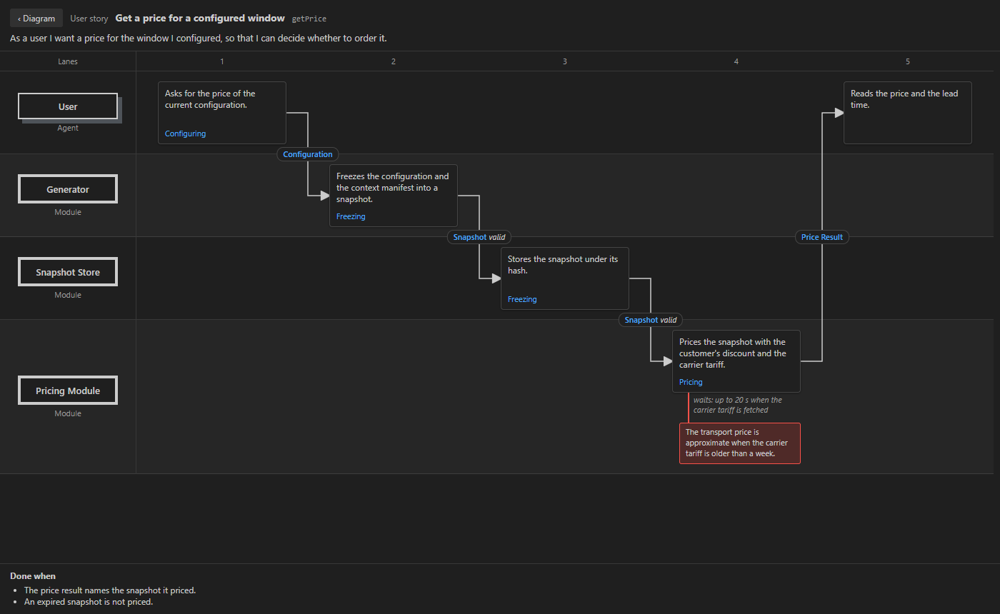
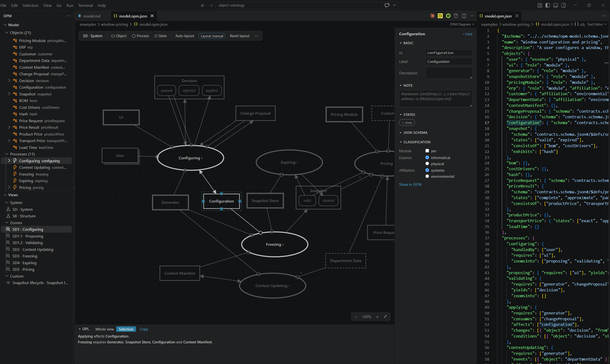
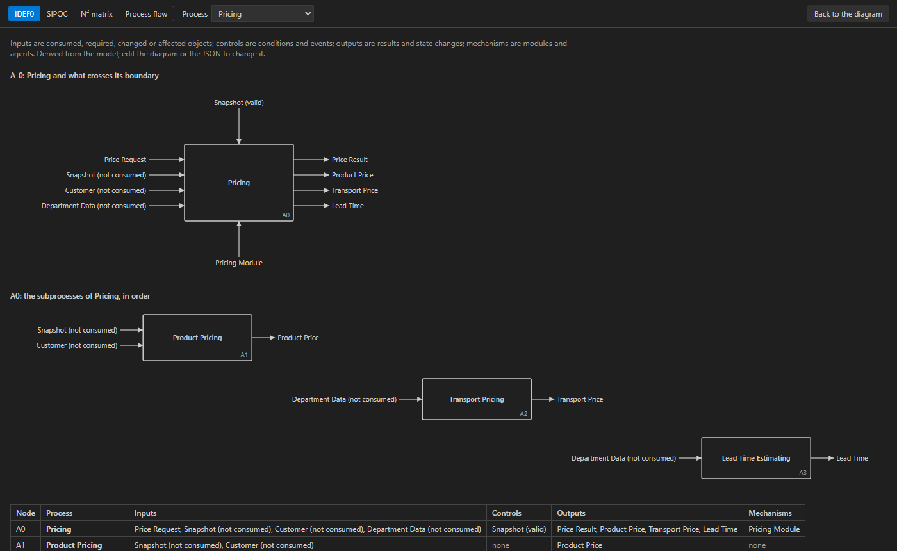

# Object Ontology: OPM models in JSON

A model describes a system with the concepts of OPM (Object-Process Methodology, ISO 19450): objects, processes, object states and the links between them. It is a JSON file with the extension `.opm.json`. Data structures stay in JSON Schema files, and objects point to their definitions.

The package has three parts:

- a validator that checks the structure of the file and the OPM rules, and compares object states with the enums in the referenced JSON Schemas;
- a renderer that produces Mermaid diagrams and OPL sentences, the controlled-English text form of OPM;
- a VS Code extension with a visual editor: the diagram is drawn in ISO 19450 notation, and every change made on it is written back to the JSON file as one undoable edit.

The `opm` command runs the validator and the renderer outside the editor, for example in CI.

## Model format

```json
{
  "$schema": "../../schema/opm-model.schema.json",
  "name": "Window configuration and pricing",
  "objects": {
    "pricingModule": { "role": "module" },
    "snapshot": { "schema": "contracts.schema.json#/$defs/snapshot", "states": ["valid", "expired"] },
    "priceRequest": {},
    "priceResult": { "states": ["complete", "approximate", "partial", "rejected"] }
  },
  "processes": {
    "pricing": {
      "requires": ["pricingModule", "snapshot"],
      "consumes": ["priceRequest"],
      "yields": ["priceResult"],
      "conditions": [{ "object": "snapshot", "state": "valid" }]
    }
  }
}
```

Identifiers are camelCase. The label is derived from the identifier (`priceResult` becomes Price Result, `ui` becomes UI) unless `label` sets another one.

An object has these optional fields:

| Field | Meaning |
|---|---|
| `role: "module"` | A part of the system that processes require. A module has no other properties: the processes it takes part in describe what it takes and gives. |
| `essence` | `informatical` (default) or `physical`. Agents are physical. |
| `affiliation` | `systemic` (default) or `environmental` for things outside the system, drawn with a dashed border. |
| `states` | At least two states. |
| `schema` | `file#/json/pointer` of the JSON Schema definition, relative to the model file. |
| `consistsOf`, `exhibits`, `isA` | Aggregation, exhibition and generalization. |
| `tagged` | Links with a free-text tag: `[{ "object": "customer", "tag": "is made for" }]` gives "Price Request is made for Customer." |

A process lists its links. Each link kind has one OPL sentence and one diagram notation:

| Field | OPL sentence | Diagram |
|---|---|---|
| `handledBy` | User handles Configuring. | `--o` labeled agent |
| `requires` | Pricing requires Pricing Module. | `--o` |
| `consumes` | Pricing consumes Price Request. | arrow into the process |
| `yields` | Pricing yields Price Result. | arrow out of the process |
| `affects` | Applying affects Configuration. | two-way arrow |
| `changes` | Expiring changes Snapshot from valid to expired. | arrows labeled with both states |
| `conditions` | Pricing occurs if Snapshot is valid, otherwise Pricing is skipped. | dotted arrow labeled c |
| `events` | Department Data initiates Context Updating. | dotted arrow labeled e |
| `zoomsInto` | Pricing zooms into Product Pricing and Transport Pricing, in that sequence. | subprocesses inside the process, numbered in order |
| `invokes` | Validating invokes Applying. | dotted arrow labeled invokes |

`requires`, `consumes` and `yields` accept an identifier or `{ "object": "snapshot", "state": "valid" }` for a link to one state. A process can also have `essence`, `affiliation`, `consistsOf` and `isA`, with the same meaning as for objects.

### Notes

An object, a process and every link can have a `note` with free text in Markdown, kept apart from `description`. The validator, OPL and the Mermaid output skip notes. A link written as a bare identifier switches to the object form when it gets a note: `{ "object": "generator", "note": "..." }`, or `{ "process": "pricing", "note": "..." }` in `invokes` and in the `consistsOf` and `isA` of a process. An entry that is already an object (`changes`, `conditions`, `events`, `tagged` or an entry with a state) gets a `note` property next to its other fields, and removing the note in the diagram editor brings a bare identifier back.

In the diagram editor, `[text](https://...)` links and bare `https://` addresses open in the browser. A relative path such as `[spec](docs/spec.md#L12)` opens that file from the model's folder at line 12. Links with other schemes are not opened.

### Layout

The optional `layout` section at the end of the file stores the positions that the diagram editor writes when something is moved: view id, thing id, `[x, y]` of the top-left corner.

```json
"layout": {
  "system": { "user": [40, 40], "configuring": [210, 158] }
}
```

A view without an entry is shown in layers from left to right, and opening or scrolling it never changes the file. The first move or the first **Arrange** in such a view writes the positions of all its things. The validator, the renderer and the markdown export ignore the layout, apart from information diagnostics about positions of things that no longer exist.

Objects are rectangles with their states in italics, modules have a thicker border, and processes are rounded shapes. Mermaid has no ellipse and no OPM link symbols, so these shapes and arrows approximate the ISO 19450 notation.

## Checks

The format schema checks field names, types and identifiers. VS Code applies it to every `*.opm.json` file, with completion and hover help. The validator then checks the meaning:

- every reference points to an object or a process of the right kind;
- every process transforms at least one object (consumes, yields, affects or changes it), itself or through its subprocesses;
- an object required or handled by a process is not also transformed by it;
- named states exist on the object, and a state change goes between two different states;
- a subprocess has one parent, and there are no cycles in `zoomsInto`, `consistsOf` or `isA`;
- a `schema` reference points to an existing file and definition, and the object's states occur in an enum of that definition.

Warnings cover objects linked to nothing, agents that are not physical, modules that a process transforms, and a process that consumes and yields the same object.

## Generated views

- a system view with the top-level processes, carrying the links of their subprocesses;
- a structure view with parts, attributes and generalizations;
- a view for every process with `zoomsInto`;
- the views listed under `views`, either one process or a list of `things`;
- a state diagram for every object with states, with transitions taken from `changes`;
- a module table: what each module performs, takes, gives and changes, derived from the processes that require it;
- the OPL text of the whole model;
- a makigami table for every user story;
- IDEF0, SIPOC, an N² matrix of modules and a swimlane flow, described under [Other views of the same model](#other-views-of-the-same-model).

## User stories (makigami)

A makigami is a swimlane map of one process: one lane per participant, the steps in time order, the information each step hands to another lane, and red cards for problems. Every user story of a model is one makigami, kept in the optional `stories` section after `views` and before `layout`. Lanes, processes and handed-over objects are identifiers of the same model, and the validator checks each of them against it.

```json
"stories": {
  "getPrice": {
    "title": "Get a price for a configured window",
    "story": "As a user I want a price for the window I configured, so that I can decide whether to order it.",
    "lanes": ["user", "generator", "pricingModule"],
    "steps": [
      { "lane": "user", "does": "Asks for the price of the current configuration.", "process": "configuring",
        "handsOver": { "object": "configuration", "to": "generator" } },
      { "lane": "generator", "does": "Freezes the configuration into a snapshot.", "process": "freezing",
        "handsOver": { "object": "snapshot", "state": "valid", "to": "pricingModule" } },
      { "lane": "pricingModule", "does": "Prices the snapshot.", "process": "pricing",
        "handsOver": { "object": "priceResult", "to": "user" },
        "waits": "up to 20 s", "problem": "The transport price is approximate when the tariff is older than a week." },
      { "lane": "user", "does": "Reads the price and the lead time." }
    ],
    "doneWhen": ["The price result names the snapshot it priced."]
  }
}
```

Story keys are camelCase, like every other identifier. `story`, `lanes`, `steps`, and `lane` and `does` in each step are required.

| Field | Meaning |
|---|---|
| `title` | Title of the story. Without it, the title is derived from the key. |
| `story` | The story sentence. |
| `lanes` | At least one lane: objects of the model that are agents (essence `physical`) or modules, in the order they are drawn from the top. |
| `steps` | At least one step, in time order. Each step gets its own column. |
| `steps[].lane` | The lane that does the step. |
| `steps[].does` | What the lane does, as a sentence. |
| `steps[].process` | The process of the model the step belongs to. |
| `steps[].handsOver` | `{ "object": ..., "state": ..., "to": ... }`: the object the step passes to the lane `to`, with an optional state of the object. |
| `steps[].waits` | A wait or a duration as free text, for example `up to a few seconds`. |
| `steps[].problem` | A problem found at the step, drawn as a red card below it. |
| `doneWhen` | Sentences that are true when the story is done. |
| `note` | On a story, a step or a hand-over: Markdown that the validator, OPL and the renderer skip. |

The validator reports these errors:

- a lane that is not an object of the model, or an object that is neither physical nor a module;
- a lane listed twice;
- a step lane or a receiving lane (`handsOver.to`) that is not among the story's lanes;
- a `process` that is not a process of the model;
- a handed-over object that does not exist, or a `state` the object does not have.

Warnings cover a lane with no step, a story in which no step hands anything over, and two mismatches between a step and its process. In the first, the lane takes no part in the process: an agent is not in `handledBy`, a module is not in `requires`. In the second, the process does not consume, yield, affect, change, require or have as a condition the handed-over object. Both checks look at the process, its subprocesses at every depth and the processes it belongs to, because the system view carries the links of subprocesses on their parents. Event links do not count for the second check.

The **Stories** tree in the OPM container lists the stories of the model that the other trees show, with error and warning icons. A click opens the story in the diagram editor, drawn over the canvas. Lanes are horizontal bands with the agent or module on the left, in the diagram's notation: a module has a thick border and an agent has a shadow. Steps are cards from left to right, one column per step, with the `does` text and the process. A hand-over is an arrow from the card to the next card of the receiving lane, labeled with the object and its state. When the receiving lane has no later step, the arrow is dashed and ends in that lane at the next column. The wait is written under the card, and a problem is a red card pinned below it. "Done when" is listed under the lanes.



The makigami is read-only: the JSON stays the only source, and a change typed in the text redraws it. A click on a lane, a process or a handed-over object closes the story and selects that thing in the diagram. **‹ Diagram**, Esc or Backspace go back to the diagram. Renaming an identifier or a state in the diagram editor renames it in the stories too. Deleting a thing leaves the stories as they are, and the validator then reports the missing references.

`opm render` and **OPM: Export Markdown** end the document with a section "User stories": for each story the sentence, a table with a column per lane and the columns Hands over, Waits and Problem, one row per step with problems marked 🟥, and the "Done when" list. OPL does not change, because stories are not OPM.

## Command line

```
npm install
npm run build
node dist/cli.js validate examples/window-pricing/model.opm.json
node dist/cli.js render examples/window-pricing/model.opm.json -o examples/window-pricing/model.md
node dist/cli.js opl examples/window-pricing/model.opm.json
```

`validate` prints `file:line:column: severity [code] message` and exits with code 1 when there are errors. `render` writes a markdown document whose Mermaid diagrams GitHub and VS Code display without extra tools. [examples/window-pricing/model.md](examples/window-pricing/model.md) is the output for the example model.

## VS Code extension

`npm run package` builds `dist/object-ontology.vsix`. Install it with:

```
code --install-extension dist/object-ontology.vsix
```

A `*.opm.json` file opens in the diagram editor. **OPM: Open Text Beside** in the editor title bar shows the JSON next to it, and **OPM: Open Diagram Beside** does the reverse from the text editor. The JSON file stays the only source: the editor has no model of its own, each operation is one edit of the text, Ctrl+Z undoes it, and a change typed in the text redraws the diagram.



The canvas shows one view at a time: the system diagram SD, the structure view SB when the model has parts, attributes or generalizations, one diagram per zoomed process (SD1, SD1.1 and so on) and the custom views from `views`. The path in the toolbar and Backspace lead one level up; a double click or Enter on a process opens its zoom and creates an empty one if the process has none. Subprocesses are stacked inside the zoomed process in their order of execution, and a vertical drag changes that order.

The left mouse button selects and moves things, and a left drag on the empty canvas draws a selection rectangle. The right and middle buttons pan the view, and a right click without movement opens the context menu. On a thing the menu lists zoom, new state, rename, cut, copy, paste, delete, show in JSON and properties. On a link it lists reverse, delete and properties, and on the empty canvas it adds an object or a process or pastes at the clicked point.

With nothing selected, only the diagram, the toolbar and a one-line OPL bar are visible. A selection dims unrelated things. **Properties** in the context menu, or F2, opens a drawer with the identifier, label, description, note, states, the JSON Schema definition and the classification. The OPL bar expands into a panel with the sentences of the whole view or of the selection; a click on a sentence selects its things.

A link is drawn from the handle of a thing, or from a state box, to another thing. Only targets with an allowed link kind light up, and the menu after the drop lists those kinds with keys 1 to 9:

| From → to | Kinds |
|---|---|
| object → process | requires, consumes, handles, condition, event, effect |
| process → object | yields, effect |
| object → object | consists of, exhibits, is a, tagged |
| process → process | invokes, consists of, is a |

A link that starts or ends in a state box keeps that state. An effect that starts in one state offers the target states in the menu and becomes a `changes` entry.

| Key | Action |
|---|---|
| O, P, S | new object, process, state of the selected object |
| Delete | delete the selection with its links, zoom entries and positions |
| F2 | edit the identifier; every reference follows |
| double click on a label | edit the label in place |
| Ctrl+C, Ctrl+V | copy the selection with the links inside it; pasted identifiers get a number when taken |
| Ctrl+A, Esc | select everything in the view, clear the selection |
| Ctrl+0, Ctrl++, Ctrl+− | fit, zoom in, zoom out |

**Arrange** in the toolbar lists the ELK algorithms: layers left to right or top to bottom, stress, force-directed, tree, radial, and a compact block that ignores the links. The chosen one arranges the view and writes the positions; Ctrl+Z restores the previous arrangement. Tree and radial arrange a spanning tree of the links, and the other links are drawn across that arrangement.

The ⋯ menu exports the view as PNG (twice the screen resolution, on the theme background) or SVG, exports markdown, saves the selection as a custom view and switches word labels on the links.

The activity bar has an OPM container with five trees. **Models** lists every `*.opm.json` file of the workspace, outside `node_modules`, `dist`, `out` and `.git`; a click opens the file in the diagram editor, and an eye icon marks the model the two trees below show. **Model** lists objects with their states and processes with their subprocesses, with error and warning icons, and **Views** lists the views. These two, **Stories**, described under [User stories](#user-stories-makigami), and **Methods**, described under [Other views](#commands-and-the-editor), follow the focused diagram or the active model text editor, and their titles carry the file name. A click in **Model** or **Views** selects the element in the diagram and switches to a view that contains it.

**OPM: New Model**, the file icon above **Models**, or **New Model** in the context menu of a folder in the explorer creates a model file and opens it. The new file holds one agent, one process, an object the process consumes and an object it yields in a state, and it passes the validator without warnings. **OPM: Find Element** searches by label or identifier. The setting `opm.schemaGlob` (default `**/*.schema.json`) chooses the schema files offered in the drawer.

**OPM: Create JSON Schema**, also in the ⋯ menu of the diagram, writes a definition for every informatical object that is not a module and has no `schema` yet, and links the objects to it in one edit of the model. States become an enum in a `state` property, parts and attributes become properties that refer to their definitions, and `isA` becomes an `allOf`. The definitions go to the schema file the objects already use, or to `<model>.schema.json` next to the model. Definitions already in the file stay as they are.

**OPM: Export Markdown** writes the views, the module table, the state diagrams, the OPL text, the user stories and the four other views as `<model>.md` next to the model. The UI of the editor follows the VS Code display language (English or Polish); OPL is always English.

## Other views of the same model

Four methods of describing processes are computed from the links of the model: IDEF0, SIPOC, an N² matrix of modules and a swimlane process flow. The format has no fields for them, so they cannot disagree with the OPM diagram; a change of a link changes all of them. `opm render` and **OPM: Export Markdown** append them to the document after everything else.

### IDEF0

An IDEF0 box has inputs on the left, controls on top, outputs on the right and mechanisms below. Inputs are the objects the process consumes. An object it requires without consuming it is an input marked "not consumed", and an object it changes or affects comes in as an input as well, in the state the change starts from. Controls are its conditions and events, with their states. Outputs are its results, its state changes written as "valid → expired", and the objects it affects. Mechanisms are the modules it requires and the agents that handle it.

A process with subprocesses gets two diagrams. A-0 is the process alone with what crosses its boundary: the links of its subprocesses count, as OPM migrates them to the parent, but an object that one subprocess yields and another one uses stays inside. A0 has one box per subprocess in the `zoomsInto` order, numbered A1, A2 and so on, and an arrow wherever one subprocess yields, changes or affects an object that a later one takes as an input or a control. An object that is both a condition and transformed by the later box arrives as a control. The markdown has an ICOM table and the A0 decomposition as a Mermaid flowchart for every top-level process and every process with subprocesses.

IDEF0 is the method to use when a process has to be explained to someone who reads functional block diagrams, or when the boundary of one function matters more than the whole system.

### SIPOC

A SIPOC table for each top-level process lists suppliers, inputs, the process, outputs and customers, one input and one output per row. Inputs are the inputs and controls of the IDEF0 box, and the process column lists the subprocesses in order. A supplier is a process elsewhere in the model that yields, changes or affects the input. An environmental input that no process supplies comes from the environment: from the environmental object it is part of when there is one (ERP for Customer in the example), otherwise from itself. Any other input without a supplier is marked "outside the model". A customer is a process elsewhere that consumes, requires, changes or affects an output, or has it as a condition or an event, together with the agents that handle that process.

A link to another state than the one the object is in does not count. Expiring leaves the snapshot expired, so it is not a supplier of the valid snapshot that Pricing has as a condition. A SIPOC fits on one page, and "outside the model" in it shows where the model stops.

### N² matrix of modules

The matrix, also called a design structure matrix, has a row and a column for every module and, unless switched off, every agent. A process is performed by the modules it requires and the agents that handle it; a subprocess with neither is performed by those of its nearest ancestor. The cell in row A and column B lists the objects that a process performed by A yields, changes or affects and another process performed by B consumes, requires, changes, affects or has as a condition or an event. The matrix is a coupling map: a pair with a long list exchanges a lot, and modules that feed each other form a cycle.

The rows are partitioned. Modules in a cycle (a strongly connected group, found with Tarjan's algorithm) stay next to each other, and the groups follow a topological order, ties broken by the order of the model. Every filled cell is then above the diagonal unless it belongs to a cycle. The cycles are listed under the matrix and marked in the editor. The markdown adds the same exchanges as a Mermaid graph.

### Process flow

A swimlane activity diagram is drawn for every process with subprocesses. The lanes are the modules and agents that perform the subprocesses. Each subprocess is an activity in the lane of the first module it requires, else of the first agent that handles it, else in its parent's lane. Activities follow the `zoomsInto` order from a start node to an end node. The arrow to the next activity carries the objects passed between the two, and a dotted arrow leads to a later activity that takes an object. In markdown each lane is a subgraph of a Mermaid flowchart. A makigami in `stories` is written by hand step by step; this flow is derived and has only what the links say.

### Commands and the editor

```
node dist/cli.js render examples/window-pricing/model.opm.json --methods idef0,dsm
node dist/cli.js idef0 examples/window-pricing/model.opm.json pricing
node dist/cli.js sipoc examples/window-pricing/model.opm.json
node dist/cli.js dsm examples/window-pricing/model.opm.json --no-agents
node dist/cli.js flow examples/window-pricing/model.opm.json configuring
```

`--methods` takes a comma-separated list of `idef0`, `sipoc`, `dsm` and `flow`, or `none`; without it `render` writes all four. The other commands print one method as markdown, for every process it applies to or for the process given.

In the diagram editor, the ⋯ menu opens each method over the canvas for the selected process, or for the zoom on screen. The **Methods** tree in the OPM container lists the four methods with the processes each one can show. The view has a tab per method, a list of processes and, for the matrix, a switch for agents. It is read-only and follows every change of the text; Esc or **Back to the diagram** closes it.



Methods that need data the format does not have are left out: value stream maps need durations and waiting times, activity-based costing needs costs, RACI needs responsibilities beyond "handles", and BPMN gateways need branching conditions.

## Development

`npm test` builds the package and runs the tests in `test/`. `npm run typecheck` checks the extension and the webview, which have separate TypeScript configurations. The core in `src/core/` has no dependency on VS Code, so the command line, the extension and the webview share the validator, the OPL text and the edit engine (`src/core/edit.ts`), which turns each editor operation into a minimal change of the JSON text.

`npm run shots` runs the diagram editor in headless Chrome with a stand-in for the VS Code API (`test/harness/`), goes through the main interactions and saves screenshots in `dist/shots`. It needs Chrome at the default Windows path or in the `CHROME` environment variable.
