# Window configuration and pricing

A user configures a window, the generator freezes the configuration into a snapshot, and the pricing module prices the snapshot with data from the ERP and other departments.

Generated from the OPM model. Edit the model file, not this document.

## Window configuration and pricing: system view

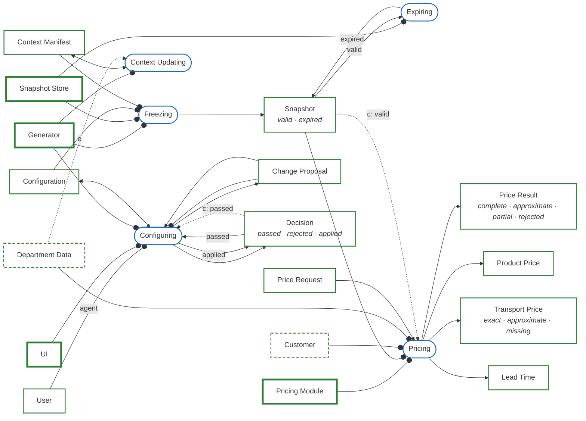

## Structure

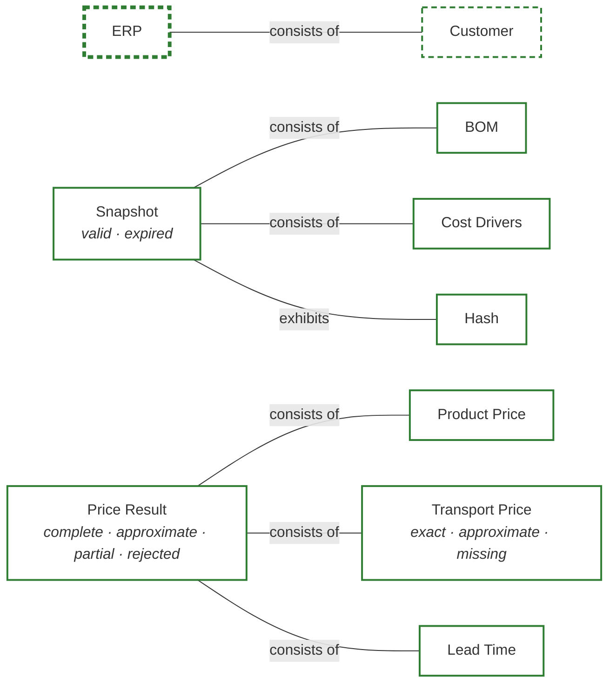

## Configuring

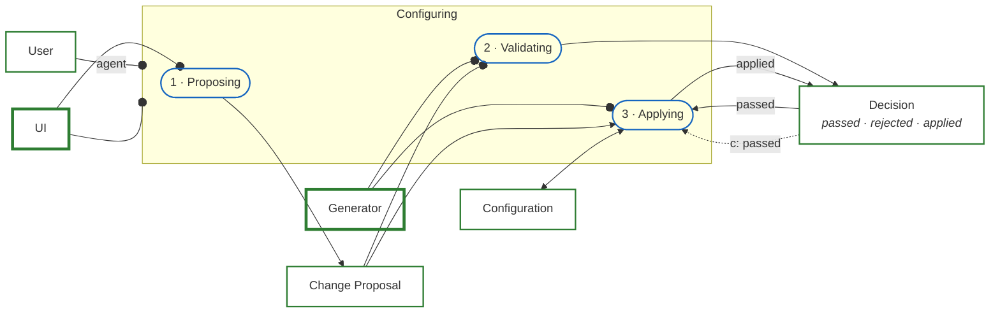

## Pricing

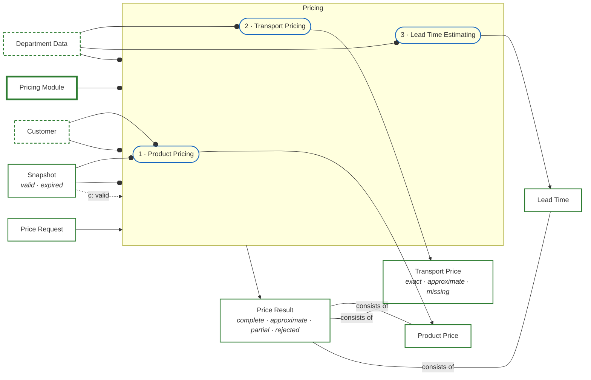

## Snapshot lifecycle

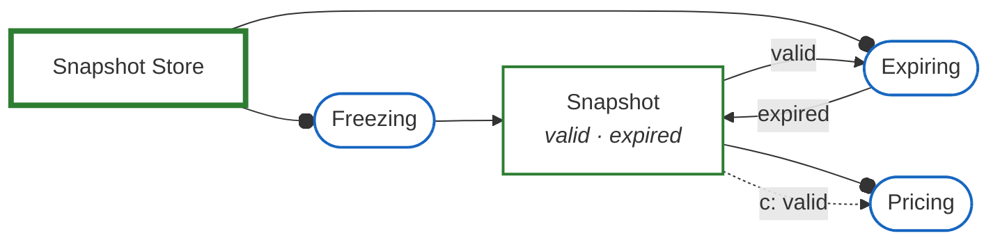

## Modules

| Module | Performs | Takes | Gives | Changes |
|---|---|---|---|---|
| UI | Configuring, Proposing | none | Change Proposal | none |
| Generator | Validating, Applying, Context Updating, Freezing | Change Proposal, Configuration, Context Manifest | Decision, Snapshot | Configuration, Decision, Context Manifest |
| Snapshot Store | Freezing, Expiring | Configuration, Context Manifest | Snapshot | Snapshot |
| Pricing Module | Pricing | Price Request, Snapshot, Customer, Department Data | Price Result | none |
| ERP | none | none | none | none |

## Object states

### Decision

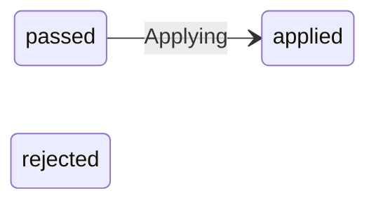

### Snapshot

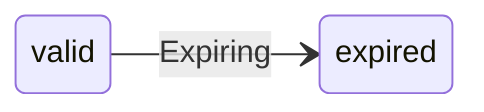

### Price Result

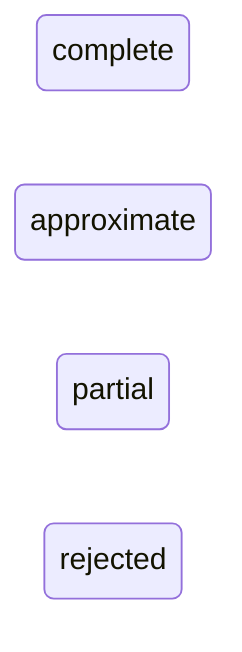

### Transport Price

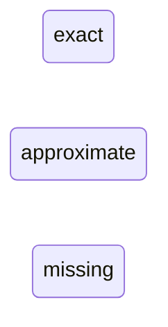

## OPL

- UI, Generator, Snapshot Store, Pricing Module and ERP are modules.
- User is physical.
- ERP is environmental.
- ERP consists of Customer.
- Customer is environmental.
- Department Data is environmental.
- Decision can be passed, rejected or applied.
- Snapshot can be valid or expired.
- Snapshot consists of BOM and Cost Drivers.
- Snapshot exhibits Hash.
- Price Result can be complete, approximate, partial or rejected.
- Price Result consists of Product Price, Transport Price and Lead Time.
- Transport Price can be exact, approximate or missing.
- User handles Configuring.
- Configuring requires UI.
- Configuring zooms into Proposing, Validating and Applying, in that sequence.
- Proposing requires UI.
- Proposing yields Change Proposal.
- Validating requires Generator and Change Proposal.
- Validating yields Decision.
- Applying requires Generator.
- Applying consumes Change Proposal.
- Applying affects Configuration.
- Applying changes Decision from passed to applied.
- Applying occurs if Decision is passed, otherwise Applying is skipped.
- Context Updating requires Generator.
- Context Updating affects Context Manifest.
- Department Data initiates Context Updating.
- Freezing requires Generator, Snapshot Store, Configuration and Context Manifest.
- Freezing yields Snapshot.
- Expiring requires Snapshot Store.
- Expiring changes Snapshot from valid to expired.
- Pricing requires Pricing Module, Snapshot, Customer and Department Data.
- Pricing consumes Price Request.
- Pricing yields Price Result.
- Pricing occurs if Snapshot is valid, otherwise Pricing is skipped.
- Pricing zooms into Product Pricing, Transport Pricing and Lead Time Estimating, in that sequence.
- Product Pricing requires Snapshot and Customer.
- Product Pricing yields Product Price.
- Transport Pricing requires Department Data.
- Transport Pricing yields Transport Price.
- Lead Time Estimating requires Department Data.
- Lead Time Estimating yields Lead Time.

## IDEF0

Inputs are the objects a process consumes, requires, changes or affects, controls its conditions and events, outputs what it yields, changes or affects, and mechanisms the modules it requires and the agents that handle it.

### A-0 Configuring

| Node | Process | Inputs | Controls | Outputs | Mechanisms |
|---|---|---|---|---|---|
| A0 | Configuring | Configuration (affected) | none | Decision, Configuration (affected), Decision (passed → applied) | User (agent), UI, Generator |
| A1 | Proposing | none | none | Change Proposal | UI |
| A2 | Validating | Change Proposal (not consumed) | none | Decision | Generator |
| A3 | Applying | Change Proposal, Configuration (affected), Decision (passed) | Decision (passed) | Configuration (affected), Decision (passed → applied) | Generator |

A0 decomposition of Configuring:

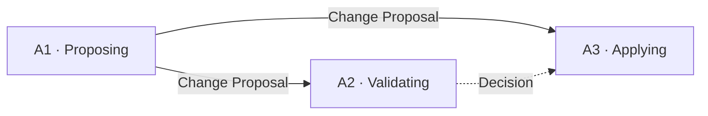

### A-0 Context Updating

| Node | Process | Inputs | Controls | Outputs | Mechanisms |
|---|---|---|---|---|---|
| A0 | Context Updating | Context Manifest (affected) | Department Data (event) | Context Manifest (affected) | Generator |

### A-0 Freezing

| Node | Process | Inputs | Controls | Outputs | Mechanisms |
|---|---|---|---|---|---|
| A0 | Freezing | Configuration (not consumed), Context Manifest (not consumed) | none | Snapshot | Generator, Snapshot Store |

### A-0 Expiring

| Node | Process | Inputs | Controls | Outputs | Mechanisms |
|---|---|---|---|---|---|
| A0 | Expiring | Snapshot (valid) | none | Snapshot (valid → expired) | Snapshot Store |

### A-0 Pricing

| Node | Process | Inputs | Controls | Outputs | Mechanisms |
|---|---|---|---|---|---|
| A0 | Pricing | Price Request, Snapshot (not consumed), Customer (not consumed), Department Data (not consumed) | Snapshot (valid) | Price Result, Product Price, Transport Price, Lead Time | Pricing Module |
| A1 | Product Pricing | Snapshot (not consumed), Customer (not consumed) | none | Product Price | none |
| A2 | Transport Pricing | Department Data (not consumed) | none | Transport Price | none |
| A3 | Lead Time Estimating | Department Data (not consumed) | none | Lead Time | none |

A0 decomposition of Pricing:

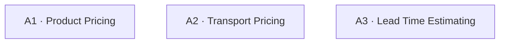

## SIPOC

One table per top-level process. Suppliers are the processes that yield, change or affect an input, customers the processes that use an output and the agents that handle them.

### Configuring

| Suppliers | Inputs | Process | Outputs | Customers |
|---|---|---|---|---|
| outside the model | Configuration (affected) | 1. Proposing | Decision | outside the model |
|  |  | 2. Validating | Configuration (affected) | Freezing |
|  |  | 3. Applying | Decision (passed → applied) | outside the model |

### Context Updating

| Suppliers | Inputs | Process | Outputs | Customers |
|---|---|---|---|---|
| outside the model | Context Manifest (affected) | Context Updating | Context Manifest (affected) | Freezing |
| Department Data (environment) | Department Data (event) |  |  |  |

### Freezing

| Suppliers | Inputs | Process | Outputs | Customers |
|---|---|---|---|---|
| Applying | Configuration (not consumed) | Freezing | Snapshot | Expiring, Pricing, Product Pricing |
| Context Updating | Context Manifest (not consumed) |  |  |  |

### Expiring

| Suppliers | Inputs | Process | Outputs | Customers |
|---|---|---|---|---|
| Freezing | Snapshot (valid) | Expiring | Snapshot (valid → expired) | Pricing, Product Pricing |

### Pricing

| Suppliers | Inputs | Process | Outputs | Customers |
|---|---|---|---|---|
| outside the model | Price Request | 1. Product Pricing | Price Result | outside the model |
| Freezing, Expiring | Snapshot (not consumed) | 2. Transport Pricing | Product Price | outside the model |
| ERP (environment) | Customer (not consumed) | 3. Lead Time Estimating | Transport Price | outside the model |
| Department Data (environment) | Department Data (not consumed) |  | Lead Time | outside the model |
| Freezing | Snapshot (valid) |  |  |  |

## N² matrix of modules

Rows give, columns take: the cell in row A and column B lists the objects that processes performed by A yield, change or affect and processes performed by B use. Agents are included. The order puts every module that gives before the modules that take from it, and keeps modules that exchange objects in a cycle next to each other; a filled cell below the diagonal belongs to a cycle.

| | 1 | 2 | 3 | 4 | 5 | 6 |
|---|---|---|---|---|---|---|
| 1. User | ■ |  |  |  |  |  |
| 2. UI |  | ■ | Change Proposal |  |  |  |
| 3. Generator |  |  | ■ | Context Manifest, Configuration, Snapshot | Snapshot |  |
| 4. Snapshot Store |  |  |  | ■ | Snapshot |  |
| 5. Pricing Module |  |  |  |  | ■ |  |
| 6. ERP |  |  |  |  |  | ■ |

No cycles.

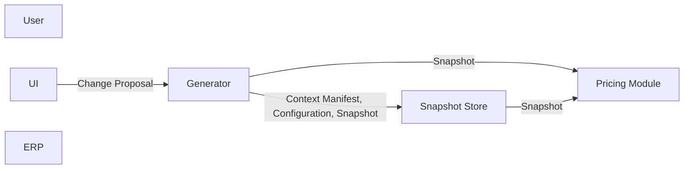

## Process flow

Subprocesses as activities in the lane of the module they require first, or of the agent that handles them. Solid arrows lead to the next activity, dotted ones to a later activity that takes an object.

### Configuring

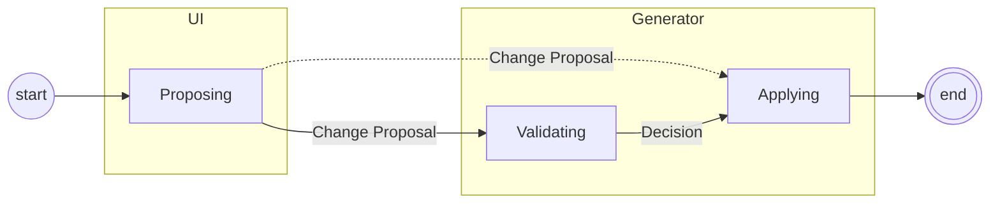

### Pricing

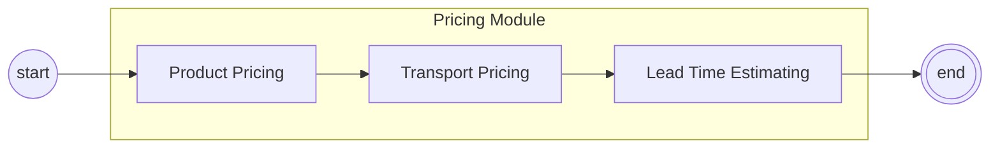
